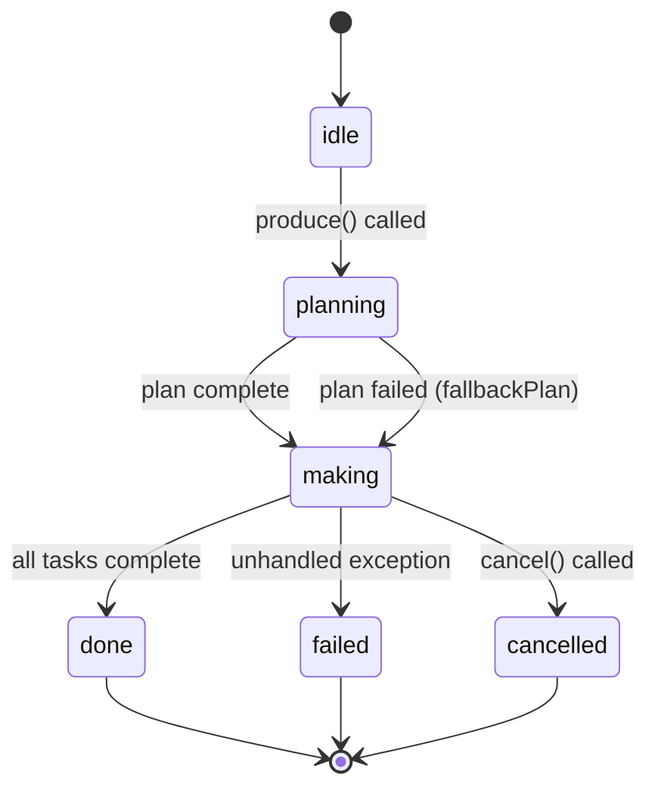
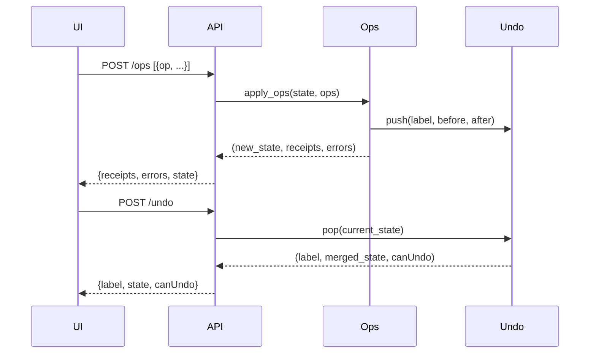
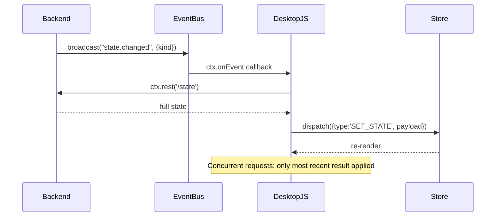
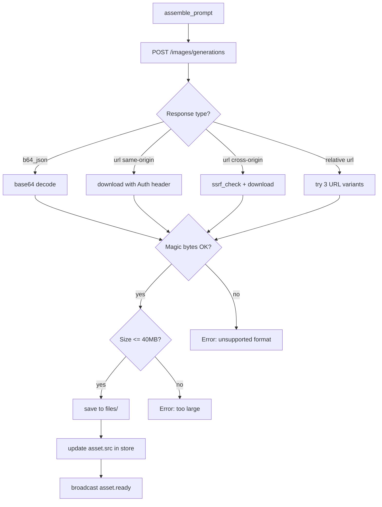

# Design Document

## hermes-media-desk

---

## Overview

`hermes-media-desk` is a unified Hermes plugin that provides the Media Desk social-media content workbench in the Hermes plugin architecture. It provides a complete content production workflow — from idea capture through AI-generated articles, images, and storyboard shots — delivered as a full-screen five-page desktop UI backed by a FastAPI server.

The plugin is a **unified package**: a FastAPI backend (`dashboard/plugin_api.py`) mounted at `/api/plugins/hermes-media-desk/` and an uncompiled ESM frontend (`desktop/plugin.js`) registered at the `/media-desk` route. Both halves default to off and are gated independently.

### Core Capabilities

- **Inspiration board** — capture ideas via URL scraping, file upload, or manual entry
- **One-click production pipeline** — concurrent LLM article generation + image generation
- **In-studio revision** — conversational AI chat dock for iterative editing
- **Schedule calendar** — monthly calendar grid + unscheduled tray
- **Insights analytics** — per-item engagement metrics + CSV export
- **Style library** — writing-style profiles with rule learning from performance data
- **Monid import** — CLI-based social post importer (Xiaohongshu, Douyin, Bilibili, TikTok, Instagram, X)
- **Bilingual (zh/en)** — full i18n throughout backend and frontend

---

## Architecture

### System Topology

```
Hermes Desktop App
├── Renderer Process
│   └── desktop/plugin.js          (uncompiled ESM, Hermes Plugin SDK)
│       ├── ROUTES_AREA → /media-desk
│       ├── SIDEBAR_NAV_AREA
│       └── Settings page
│
└── Gateway Process (Python)
    └── plugin_api.py               (FastAPI APIRouter)
        ├── /api/plugins/hermes-media-desk/*
        ├── plugin_data_dir/state.json
        ├── plugin_data_dir/settings.json
        └── plugin_data_dir/files/

External:
  ├── ctx.llm (Hermes LLM Client)
  ├── Image HTTP endpoint (OpenAI-compatible)
  ├── ctx.register_image_gen_provider() (tool provider)
  └── Monid CLI (child process)
```

### Communication Patterns

| Direction | Mechanism |
|-----------|-----------|
| Frontend → Backend | `ctx.rest(path, opts)` → HTTP to `/api/plugins/hermes-media-desk/` |
| Backend → Frontend (push) | `broadcast_plugin_event("hermes-media-desk", name, payload)` → `ctx.onEvent('plugin.hermes-media-desk.<name>', fn)` |
| Backend → LLM | `ctx.llm.acomplete()` / `ctx.llm.acomplete_structured()` |
| Backend → Image API | `httpx.AsyncClient.post(baseUrl + "/images/generations")` |
| Backend → Monid | `asyncio.create_subprocess_exec(monid_path, ...)` |

### Module Dependency Graph

```
plugin_api.py
  ├── store.py          StoreManager (load/save/migrate/atomic write)
  ├── settings.py       SettingsManager (validate/load/save)
  ├── ops.py            applyOps + 25 handlers
  ├── produce.py        ProductionPipeline (background task, semaphore)
  ├── ai.py             LLM prompts, plan/article/chat/style_extract
  ├── images.py         ImageGenerator (HTTP + provider modes)
  ├── export.py         save_production, reveal_production
  ├── monid.py          MonidRunner (CLI discovery, platform normalizers)
  ├── harvest.py        capture_url, ssrf_check
  ├── style.py          style_extract, skills_learn, skills_export
  ├── seed.py           seed_state (25 items + 15 presets + metrics)
  └── i18n.py           get_lang(request), bilingual string maps
```

---

## Components and Interfaces

### Backend: `store.py` — StoreManager

Owns all reads and writes to `state.json`. Thread-safety is provided by an `asyncio.Lock`-serialized write queue; mtime-based invalidation handles multi-process access (web + desktop halves sharing the same Python process, plus any external writer).

```python
class StoreManager:
    _path: Path
    _lock: asyncio.Lock
    _cache: dict | None
    _mtime: float | None

    async def load(self) -> dict:
        """Read state, running migrations. Returns fresh dict on parse failure."""

    async def save(self, state: dict) -> None:
        """Atomic write via tmp file + rename. Serialized through _lock."""

    async def update(self, fn: Callable[[dict], dict]) -> dict:
        """Load → transform → save in one locked operation. Returns new state."""

    def _migrate(self, state: dict) -> dict:
        """Apply all forward schema migrations. Idempotent."""

    def _migrate_presets(self, state: dict) -> dict:
        """Replace stale presets, add missing built-ins."""
```

**Atomic write sequence:**
1. Acquire `_lock`
2. Serialize state to JSON string
3. Write to `state.json.<pid>.tmp`
4. `os.replace(tmp, state.json)` — atomic on POSIX and Windows (same volume)
5. Release `_lock`

**Mtime invalidation:** On each `load()`, compare `Path.stat().st_mtime_ns` against `_mtime`. If changed, re-read from disk.

### Backend: `settings.py` — SettingsManager

Manages `settings.json` with file permissions `0o600`. Same tmp+rename write strategy. Validates all fields before persisting.

```python
DEFAULTS = {
    "image": {
        "source": "http", "baseUrl": "", "model": "", "apiKey": "",
        "size": "1536x1024", "quality": "", "toolSize": "1536x1024",
        "toolQuality": "", "extra": ""
    },
    "assistant": {"provider": "", "model": ""},
    "voice": "", "exportDir": "", "imageCount": 2, "shotCount": 6, "language": "auto"
}

class SettingsManager:
    async def load(self) -> dict
    async def save(self, patch: dict) -> dict  # validate then merge+write
    async def get_public(self) -> dict          # masks apiKey → hasKey + keyHint
    def _validate(self, patch: dict) -> None    # raises HTTPException(400) on invalid
```

**Validation rules:**
- `image.source`: must be `"http"` or `"tool"`
- `image.baseUrl`: if non-empty, must start with `http://` or `https://`
- `image.extra`: if non-empty, must parse as JSON object (not array)
- `assistant.provider` / `assistant.model`: both present or both absent
- `toolSize`: one of `["1024x1024", "1024x1536", "1536x1024", "auto"]`
- `toolQuality`: one of `["low", "medium", "high", "auto"]`
- `language`: one of `["auto", "zh", "en"]` — invalid silently ignored
- `imageCount`: clamped `int(max(0, min(4, v)))` — non-finite retains current
- `shotCount`: clamped `int(max(0, min(12, v)))` — non-finite retains current

### Backend: `ops.py` — Ops Pipeline

The single write path for all state mutations. Accepts a list of op objects, processes sequentially, collects receipts and errors.

```python
OP_HANDLERS: dict[str, Callable] = {
    "add_item":       handle_add_item,
    "update_item":    handle_update_item,
    "delete_item":    handle_delete_item,
    "schedule_item":  handle_schedule_item,
    "set_status":     handle_set_status,
    "save_draft":     handle_save_draft,
    "update_production": handle_update_production,
    "add_person":     handle_add_person,
    "update_person":  handle_update_person,
    "delete_person":  handle_delete_person,
    "add_angle":      handle_add_angle,
    "update_angle":   handle_update_angle,
    "delete_angle":   handle_delete_angle,
    "add_style":      handle_add_style,
    "update_style":   handle_update_style,
    "delete_style":   handle_delete_style,
    "set_style":      handle_set_style,
    "add_skill":      handle_add_skill,
    "update_skill":   handle_update_skill,
    "delete_skill":   handle_delete_skill,
    "add_metric":     handle_add_metric,
    "add_account":    handle_add_account,
    "update_account": handle_update_account,
    "delete_account": handle_delete_account,
    "clear_samples":  handle_clear_samples,
}

FIELD_WHITELISTS: dict[str, set[str]] = {
    "add_item": {"title","body","kind","platform","tags","source","media","pos","parentId","scheduledAt","sample"},
    "update_item": {"title","body","kind","platform","tags","source","media","pos","parentId","scheduledAt"},
    # ... (all 25 ops)
}

async def apply_ops(
    state: dict,
    ops: list[dict],
    undoable: bool = True
) -> tuple[dict, list[dict], list[str]]:
    """
    Returns (new_state, receipts, errors).
    Each op is stripped to its whitelist before the handler runs.
    Exceptions in a handler are caught, recorded in errors, pipeline continues.
    Pushes UndoEntry when undoable=True and state actually changed.
    """
```

**Field coercion in handlers:**
- URL fields: validated against `^https?://` prefix; non-matching stored as `null`
- Date fields: `datetime.fromisoformat()` check; invalid stored as `null`
- Text truncation: UTF-8 encode → slice to byte limit → decode safely

**Status transition logic (in `handle_set_status` and `handle_schedule_item`):**
```
set publishedAt = utcnow().isoformat() when transitioning TO "published" and publishedAt not set
delete publishedAt when transitioning AWAY FROM "published"
scheduledAt set + non-null: status → "ready" if was ready/draft, else "outline"
scheduledAt set to null + status not explicitly set: status → "draft" if was "ready", "idea" if was "outline"
```

### Backend: `produce.py` — Production Pipeline

```python
class ProductionPipeline:
    _running: dict[str, asyncio.Task]  # itemId → running task

    async def start(self, item_id: str, state: dict, settings: dict) -> bool:
        """Returns False if already running for this item."""

    async def cancel(self, item_id: str) -> None:
        """Cancels the asyncio.Task, sets status=cancelled."""

    async def _run(self, item_id: str) -> None:
        """Main pipeline coroutine."""

    async def settle_all(self) -> None:
        """Mark any production.status=running as failed. Called on first GET /state."""
```

**Pipeline flow:**
```
_run(item_id):
  1. plan = await _plan_stage(item)              # ctx.llm.acomplete(light=True, timeout=240s)
     on failure: plan = fallback_plan(item)
  2. plan = normalize_plan(plan, settings)       # truncate, slice to imageCount/shotCount
  3. await store.update(set stage="making", status="running", ...plan_fields)
  4. broadcast("state.changed", {"kind": "ops"})
  5. semaphore = asyncio.Semaphore(3)
     tasks = [
       article_task(plan, item, semaphore),
       *[image_task(prompt, target, semaphore) for prompt in cover+figures+shots]
     ]
     await asyncio.gather(*tasks, return_exceptions=True)
  6. await store.update(set status="done", stage="done", finishedAt=utcnow())
     advance item.status: idea/outline → draft, draft → ready
  7. broadcast("state.changed", {"kind": "produce_completion"})
```

**Image task (per asset):**
```
image_task(prompt, target):
  assembled = assemble_prompt(prompt, target_kind)  # prepend style directive
  for attempt in range(3):
    try:
      bytes = await generate_image(assembled)
      path = save_to_files(bytes, target)
      await store.update(set asset.src=path, asset.status="done")
      broadcast("asset.ready", {item_id, target, src})
      return
    except HTTP429:
      await asyncio.sleep([6000, 14000][attempt] / 1000)
    except (HTTP401, HTTP403, HTTP404, non-retryable):
      break
  await store.update(set asset.status="failed")
  broadcast("state.changed", {"kind": "asset_error"})
```

### Backend: `ai.py` — LLM Prompts

All LLM calls go through this module. No direct HTTP to LLM endpoints; all calls use `ctx.llm.acomplete()`.

```python
async def generate_plan(ctx, item: dict, style: dict | None, skills: list, lang: str) -> dict:
    """light=True, purpose="content-creation", task="generate-plan", timeout=240s"""

async def generate_article(ctx, plan: dict, item: dict, style: dict | None, skills: list, lang: str) -> str:
    """light=False, purpose="content-creation", task="generate-article", timeout=240s"""

async def chat_reply(ctx, message: str, history: list, item: dict, production: dict | None,
                     style: dict | None, lang: str) -> dict:
    """light=True, purpose="content-creation", task="chat-reply"
    Returns: {reply, ops, revise, actions}"""

async def extract_style(ctx, text: str, lang: str) -> dict:
    """Structured output: {name, tone, sentences, opening, structure, words, avoid, samples}"""
```

**Voice block assembly:**
```python
def build_voice_block(style: dict) -> str:
    if not style:
        return ""
    return f"""<voice>
Tone: {style['tone']}
Sentence patterns: {style['sentences']}
Opening: {style['opening']}
Structure: {style['structure']}
Words to use: {', '.join(style.get('words', []))}
Words to avoid: {', '.join(style.get('avoid', []))}
Sample phrases: {style.get('samples', '')}
</voice>"""

def build_skills_block(skills: list) -> str:
    active = [s for s in skills if s['status'] in ('active', 'exported')]
    if not active:
        return ""
    rules = '\n'.join(f"- {s['text']}" for s in active)
    return f"<rules>\n{rules}\n</rules>"
```

**LLM provider selection:**
```python
def llm_kwargs(settings: dict) -> dict:
    p = settings["assistant"]["provider"]
    m = settings["assistant"]["model"]
    if p and m:
        return {"provider": p, "model": m}
    return {}
```

### Backend: `images.py` — Image Generator

```python
class ImageGenerator:
    async def generate(self, prompt: str, settings: dict) -> bytes:
        if settings["image"]["source"] == "tool":
            return await self._generate_via_tool(prompt, settings)
        return await self._generate_via_http(prompt, settings)

    async def _generate_via_http(self, prompt: str, settings: dict) -> bytes:
        # POST to baseUrl/images/generations
        # Parse response: b64_json → decode, url → download
        # Validate magic bytes, size limit

    async def _resolve_relative_url(self, url: str, base_url: str) -> str:
        # Try: strip /v1, prepend mount path, prepend site root

    async def _download_image(self, url: str, base_url: str, api_key: str) -> bytes:
        # Same-origin: add Authorization header
        # Cross-origin: apply ssrf_check first

    def _validate_image(self, data: bytes) -> str:
        # Check magic bytes → return extension or raise
        MAGIC = {
            b'\x89PNG': 'png',
            b'\xff\xd8': 'jpg',
            b'RIFF': 'webp',   # + offset 8: WEBP
            b'GIF8': 'gif',
        }
```

### Backend: `harvest.py` — SSRF Check

```python
async def ssrf_check(url: str, *, max_size: int = 1_572_864, timeout: float = 8.0,
                     max_redirects: int = 4) -> bytes:
    """
    Validates URL scheme, resolves hostname, checks not RFC1918/loopback/link-local,
    fetches with httpx, returns body bytes.
    Raises HTTPException(400) on any SSRF violation.
    """

PRIVATE_NETS = [
    ipaddress.ip_network("10.0.0.0/8"),
    ipaddress.ip_network("172.16.0.0/12"),
    ipaddress.ip_network("192.168.0.0/16"),
    ipaddress.ip_network("127.0.0.0/8"),
    ipaddress.ip_network("169.254.0.0/16"),
    ipaddress.ip_network("::1/128"),
    ipaddress.ip_network("fc00::/7"),
    ipaddress.ip_network("fe80::/10"),
]

async def capture_url(url: str) -> dict:
    """Fetch URL via ssrf_check, parse HTML for title/description/og:image/site_name."""
```

### Backend: `monid.py` — Monid Runner

```python
SEARCH_PATHS = [
    # From PATH env
    "/opt/homebrew/bin",
    "~/.npm-global/bin",
    "~/.local/bin",
    "~/.volta/bin",
    "~/.bun/bin",
]

SHORT_LINK_DOMAINS = {"xhslink.com", "v.douyin.com", "b23.tv", "vm.tiktok.com", "vt.tiktok.com"}

class MonidRunner:
    _exe: str | None  # discovered path

    async def find_exe(self) -> str | None:
        """Search PATH + common dirs + login shell. Windows: resolve .cmd → node entry.js"""

    async def balance(self) -> dict:
        """Run: monid balance -j → parse JSON → return status dict"""

    async def import_posts(self, platform: str, url: str, count: int = 20) -> list[dict]:
        """Run: monid fetch <platform> <url> --count <n> --json → parse → normalize"""

    def normalize(self, platform: str, raw: dict) -> dict:
        """Map platform-specific fields to common schema. Missing fields → None."""

PLATFORM_NORMALIZERS = {
    "Xiaohongshu": lambda r: {
        "id": r.get("note_id"), "title": r.get("title") or r.get("desc"),
        "body": r.get("desc"), "publishedAt": r.get("time"), "url": r.get("note_url"),
        "cover": r.get("cover"), "views": r.get("view_num"), "likes": r.get("liked_count"),
        "comments": r.get("comment_count"), "saves": r.get("collect_count"), "shares": None,
    },
    "Douyin": lambda r: {
        "id": r.get("aweme_id"), "title": r.get("desc"), "body": r.get("desc"),
        # ... etc
    },
    # Bilibili, TikTok, Instagram, X ...
}
```

### Backend: `undo.py` — Three-Way Merge

```python
MAX_UNDO = 30

class UndoStack:
    _entries: list  # [{label, before, after}]

    def push(self, label: str, before: dict, after: dict) -> None:
        if before == after:
            return  # no-op
        if len(self._entries) >= MAX_UNDO:
            self._entries.pop(0)
        self._entries.append({"label": label, "before": before, "after": after})

    def pop(self, current: dict) -> tuple[str | None, dict, bool]:
        if not self._entries:
            return None, current, False
        entry = self._entries.pop()
        merged = revert_change(entry["before"], entry["after"], current)
        return entry["label"], merged, bool(self._entries)


def revert_change(before: Any, after: Any, current: Any) -> Any:
    if before == after:
        return current
    if current == after:
        return copy.deepcopy(before)
    if isinstance(before, dict) and isinstance(after, dict) and isinstance(current, dict):
        result = dict(current)
        for key in set(before) | set(after):
            result[key] = revert_change(before.get(key), after.get(key), current.get(key))
        return result
    if isinstance(before, list) and isinstance(after, list) and isinstance(current, list):
        if _is_keyed(before) and _is_keyed(after) and _is_keyed(current):
            return _revert_keyed_array(before, after, current)
        if len(before) == len(after) == len(current):
            return [revert_change(b, a, c) for b, a, c in zip(before, after, current)]
    return current


def _is_keyed(arr: list) -> bool:
    return all(isinstance(x, dict) and isinstance(x.get("id"), str) for x in arr)


def _revert_keyed_array(before: list, after: list, current: list) -> list:
    before_map = {x["id"]: x for x in before}
    after_map = {x["id"]: x for x in after}
    current_map = {x["id"]: x for x in current}
    added_ids = set(after_map) - set(before_map)   # added in this step → remove
    removed_ids = set(before_map) - set(after_map)  # deleted in this step → re-insert

    result = []
    for item in current:
        iid = item["id"]
        if iid in added_ids:
            continue  # remove items added in this step
        if iid in before_map and iid in after_map:
            result.append(revert_change(before_map[iid], after_map[iid], item))
        else:
            result.append(item)

    # Re-insert deleted rows at their original positions
    for i, item in enumerate(before):
        if item["id"] in removed_ids:
            pos = min(i, len(result))
            result.insert(pos, copy.deepcopy(item))

    return result
```

### Backend: `export.py` — Content Export

```python
FORBIDDEN_CHARS = r'\\/:*?"<>|'

def sanitize_filename(name: str) -> str:
    for ch in FORBIDDEN_CHARS:
        name = name.replace(ch, "")
    return name.strip() or "export"

async def save_production(item_id: str, production: dict, settings: dict,
                          video_cover_b64: str | None, lang: str) -> dict:
    """Create export folder, copy assets, write markdown files."""

async def reveal_production(production: dict) -> None:
    """Open saved_path in OS file manager."""
```

**Export file naming by language:**
```python
FILE_NAMES = {
    "zh": {
        "cover": "cover-original",
        "video_cover": "video-cover.jpg",
        "figure": "figure-{n}",
        "shot": "shot-{n:02d}",
        "script": "script.md",
        "storyboard": "script.md",
    },
    "en": {
        "cover": "cover-original",
        "video_cover": "video-cover.jpg",
        "figure": "figure-{n}",
        "shot": "shot-{n:02d}",
        "script": "script.md",
        "storyboard": "storyboard.md",
    }
}
```

### Backend: `plugin_api.py` — Route Definitions

```python
from fastapi import APIRouter, Depends, Request, HTTPException
router = APIRouter()

# Security dependency applied to all POST routes
async def check_origin(request: Request):
    site = request.headers.get("sec-fetch-site")
    if site not in ("same-origin", "none"):
        raise HTTPException(status_code=403, detail="Forbidden")

# State management singletons (initialized on first import)
store: StoreManager
settings_mgr: SettingsManager
undo_stack: UndoStack
pipeline: ProductionPipeline
image_gen: ImageGenerator
monid_runner: MonidRunner

# GET routes — no origin check needed
@router.get("/state")
@router.get("/production")
@router.get("/settings")
@router.get("/models")
@router.get("/insights")
@router.get("/monid/status")
@router.get("/assets/{filename}")
@router.get("/files/{filename}")

# POST routes — all require check_origin dependency
@router.post("/upload", dependencies=[Depends(check_origin)])
@router.post("/ops", dependencies=[Depends(check_origin)])
@router.post("/undo", dependencies=[Depends(check_origin)])
@router.post("/chat", dependencies=[Depends(check_origin)])
@router.post("/chat/clear", dependencies=[Depends(check_origin)])
@router.post("/produce", dependencies=[Depends(check_origin)])
@router.post("/produce/cancel", dependencies=[Depends(check_origin)])
@router.post("/produce/regen", dependencies=[Depends(check_origin)])
@router.post("/produce/save", dependencies=[Depends(check_origin)])
@router.post("/produce/reveal", dependencies=[Depends(check_origin)])
@router.post("/style/extract", dependencies=[Depends(check_origin)])
@router.post("/monid/import", dependencies=[Depends(check_origin)])
@router.post("/settings", dependencies=[Depends(check_origin)])
@router.post("/settings/test", dependencies=[Depends(check_origin)])
@router.post("/capture-url", dependencies=[Depends(check_origin)])
@router.post("/account/refresh", dependencies=[Depends(check_origin)])
@router.post("/skills/learn", dependencies=[Depends(check_origin)])
@router.post("/skills/export", dependencies=[Depends(check_origin)])
```

### Desktop: `plugin.js` — Entry Point

```javascript
import { host, useValue, atom, computed, queryClient,
         ROUTES_AREA, SIDEBAR_NAV_AREA,
         jsx, jsxs } from '@hermes/plugin-sdk'
import { jsx, jsxs } from 'react/jsx-runtime'
import { useState, useReducer, useEffect, useContext,
         createContext, useCallback, useRef } from 'react'

export default {
  id: 'hermes-media-desk',
  name: 'Media Desk',
  defaultEnabled: false,

  register(ctx) {
    // Register locale bundles
    ctx.i18n.register({ zh: ZH_BUNDLE, en: EN_BUNDLE })
    const t = (key, ...args) => ctx.i18n.t(key, ...args)
    const locale = () => ctx.i18n.locale  // 'zh' | 'en'

    // Helper: ctx.rest with lang header
    const rest = (path, opts = {}) => ctx.rest(path, {
      ...opts,
      headers: { 'x-media-desk-lang': locale(), ...(opts.headers || {}) }
    })

    // Register route + sidebar
    ctx.register({
      id: 'page',
      area: ROUTES_AREA,
      data: { path: '/media-desk' },
      render: () => jsx(AppRoot, { ctx, rest, t, locale })
    })
    ctx.register({
      id: 'nav',
      area: SIDEBAR_NAV_AREA,
      data: { path: '/media-desk', label: t('nav.label'), codicon: 'edit' }
    })

    // Settings page
    ctx.registerSettingsPage({
      id: 'settings',
      title: t('settings.title'),
      icon: 'settings-gear',
      render: () => jsx(SettingsPage, { rest, t })
    })

    // Push event subscriptions (via ctx.onEvent — auto-disposed on unload)
    ctx.onEvent('plugin.hermes-media-desk.state.changed', () => {
      rest('/state').then(state => dispatch({ type: 'SET_STATE', payload: state }))
    })
    ctx.onEvent('plugin.hermes-media-desk.asset.ready', ({ item_id, target, src }) => {
      dispatch({ type: 'SET_ASSET', payload: { item_id, target, src } })
    })
  }
}
```

### Desktop: State Management

```javascript
// Global app state shape
const initialState = {
  serverState: null,     // full state from GET /state
  activeView: 'home',    // 'home'|'content'|'schedule'|'insights'|'style'
  openItemId: null,      // string | null
  studioMode: false,
  filters: {},
  error: null,
  loading: true,
}

function reducer(state, action) {
  switch (action.type) {
    case 'SET_STATE':     return { ...state, serverState: action.payload, loading: false, error: null }
    case 'SET_ASSET':     return applyAssetUpdate(state, action.payload)
    case 'SET_VIEW':      return { ...state, activeView: action.payload }
    case 'OPEN_ITEM':     return { ...state, openItemId: action.payload, studioMode: true }
    case 'CLOSE_STUDIO':  return { ...state, openItemId: null, studioMode: false }
    case 'SET_ERROR':     return { ...state, error: action.payload }
    case 'SET_LOADING':   return { ...state, loading: action.payload }
    default:              return state
  }
}

// Persisted keys to ctx.storage
const STORAGE_KEYS = {
  activeView: 'activeView',
  openItemId: 'openItemId',
  filters: 'filters',
}
```

### Desktop: Five-Page Layout

```
AppRoot
├── ErrorBoundary
├── LoadingGuard (shows error if /state fails)
└── AppShell
    ├── TabBar (home / content / schedule / insights / style)
    ├── PageContent (switch on activeView)
    │   ├── HomePage     ← Inspiration board (card grid + feed)
    │   ├── ContentPage  ← Table/kanban with status filters
    │   ├── SchedulePage ← Monthly calendar + unscheduled tray
    │   ├── InsightsPage ← Charts + CSV export + Monid wizard
    │   └── StylePage    ← Style card library + rules editor
    └── StudioOverlay (rendered when openItemId != null)
        ├── IdeaCard (title edit, style picker)
        ├── ProgressCard (while status=running)
        ├── HeroTile (cover + figure collage)
        ├── ArticleTile (editable, text selection → chat)
        ├── ShotsTile (storyboard grid)
        └── ChatDock (chat history + input)
```

---

## Data Models

### state.json Schema

```typescript
interface State {
  items: Item[]
  people: Person[]
  angles: Angle[]
  styles: StyleCard[]
  skills: Skill[]
  accounts: Account[]
  metrics: Metric[]
  chat: ChatMessage[]
  activeStyleId: string | null
  sampleLang: "zh" | "en"
  sampleCleared: boolean
  presetVersion: number
  modelStatus: { ok: boolean; error: string | null }
}

interface Item {
  id: string
  title: string
  body: string
  kind: "image" | "video" | "web" | "quote" | "note"
  status: "idea" | "outline" | "draft" | "ready" | "published"
  platform: Platform | null
  tags: string[]
  source: string | null
  media: { src: string | null; type: string | null } | null
  pos: number
  parentId: string | null
  scheduledAt: string | null   // ISO 8601
  publishedAt: string | null   // ISO 8601, UTC
  production: Production | null
  drafts: Draft[]
  sample: boolean
  otherLang: Record<string, Record<string, string>>  // {zh: {title:...}, en: {...}}
}

type Platform =
  | "WeChat" | "Xiaohongshu" | "Douyin" | "Bilibili" | "Channels"
  | "TikTok" | "Instagram" | "YouTube" | "X"

interface Production {
  status: "idle" | "planning" | "making" | "done" | "failed" | "cancelled"
  stage: "plan" | "making" | "done"
  title: string
  coverText: string
  facts: string[]
  outline: string
  cover: Asset
  images: Asset[]
  shots: Shot[]
  article: string
  savedPath: string | null
  finishedAt: string | null
}

interface Asset {
  status: "idle" | "pending" | "running" | "done" | "failed"
  src: string | null    // relative path: "media-desk/files/<name>"
  prompt: string
}

interface Shot extends Asset {
  shotSize: string
  duration: string
  voiceOver: string
  visual: string
}

interface StyleCard {
  id: string
  name: string
  summary: string
  tone: string
  sentences: string
  opening: string
  structure: string
  words: string[]
  avoid: string[]
  samples: string
  source: string | null
  accountKey: string | null
  preset: boolean
  sample: boolean
  category: string
}

type SkillStatus = "proposed" | "active" | "exported"
interface Skill {
  id: string
  text: string
  status: SkillStatus
  sample: boolean
}

interface Account {
  id: string
  platform: Platform
  nickname: string
  url: string
  avatar: string | null
  sample: boolean
}

interface Metric {
  id: string
  itemId: string
  date: string   // YYYY-MM-DD
  views: number
  likes: number
  comments: number
  shares: number
  saves: number
}

interface ChatMessage {
  id: string
  role: "user" | "assistant"
  content: string
  itemId: string | null
  undoable: boolean
}
```

### settings.json Schema

```typescript
interface Settings {
  image: {
    source: "http" | "tool"
    baseUrl: string
    model: string
    apiKey: string    // write-only; never returned in GET /settings
    size: string
    quality: string
    toolSize: "1024x1024" | "1024x1536" | "1536x1024" | "auto"
    toolQuality: "low" | "medium" | "high" | "auto" | ""
    extra: string     // JSON object string or ""
  }
  assistant: {
    provider: string
    model: string
  }
  voice: string
  exportDir: string
  imageCount: number  // 0–4
  shotCount: number   // 0–12
  language: "auto" | "zh" | "en"
}
```

### GET /settings response (public shape)

```typescript
interface PublicSettings extends Omit<Settings, 'image'> {
  image: Omit<Settings['image'], 'apiKey'> & {
    hasKey: boolean
    keyHint: string   // last 4 chars if len >= 4, else ""
  }
  imageReady: boolean
}
```

### State Migration Table

| Version | Migration |
|---------|-----------|
| 0 → 1 | Add `sampleCleared: false`, `presetVersion: 0` |
| 1 → 2 | Add `modelStatus: {ok: true, error: null}` |
| 2 → 3 | Add `angles: []` if missing |
| `presetVersion` check | Replace stale presets, add missing built-ins (run on each load) |

### Seed Data Structure

```
seed_state():
  items: 25 sample items (sample=True)
    - 5 per platform: WeChat, Xiaohongshu, Douyin, Bilibili, Channels
    - statuses distributed: 5 idea, 5 outline, 5 draft, 5 ready, 5 published
    - stored bilingual under item.otherLang

  people: 4 sample personas (sample=True)
  angles: 8 sample angles (sample=True)
  skills: 3 sample skills (sample=True, status="active")
  accounts: 4 sample accounts (sample=True)
  
  metrics: decaying daily views for 4 published items
    for each item, 9 days of metrics:
      views = int(peak * exp(-day * 0.55) * uniform(0.8, 1.2))
      likes = int(views * 0.08)
      comments = int(views * 0.02)
      shares = int(views * 0.03)
      saves = int(views * 0.05)

  styles: 15 Presets organized in 8 categories:
    Tech & Gadgets: [ai_tech, gadget]
    Travel & Food: [travel, food]
    Vlog & Lifestyle: [vlog, home]
    Insights & Thoughts: [reading, career]
    Tutorials: [tutorial, business]
    Reviews: [beauty, outfit]
    Stories: [story, parent]
    Trending News: [news]
    (note: news is 1 of 15 making 8 categories with 2 each except one has 1)
```

---

## Correctness Properties

*A property is a characteristic or behavior that should hold true across all valid executions of a system — essentially, a formal statement about what the system should do. Properties serve as the bridge between human-readable specifications and machine-verifiable correctness guarantees.*

### Property 1: Undo Identity

*For any* value `x` and any current state `c`, calling `revert_change(x, x, c)` shall return `c` unchanged.

**Validates: Requirements 6.9**

### Property 2: Undo Round-Trip

*For any* three-way merge inputs `(before, after, current)` where `current` deep-equals `after`, calling `revert_change(before, after, current)` shall return a value that deep-equals `before`.

**Validates: Requirements 6.10**

### Property 3: Undo Stack Bound

*For any* sequence of mutating ops of arbitrary length, the undo stack length shall never exceed 30 entries.

**Validates: Requirements 6.1, 6.2**

### Property 4: Op Isolation on Failure

*For any* list of ops where one op in the list fails (validation error or exception), the state changes from other ops in the same list shall be applied independently, and the failing op's target keys shall remain at their pre-call values.

**Validates: Requirements 5.3**

### Property 5: Op Confluence on Disjoint Keys

*For any* two ops `A` and `B` that read and write non-overlapping state keys, applying `[A, B]` shall produce identical receipts and state as applying `[B, A]`.

**Validates: Requirements 5.12**

### Property 6: Text Field Truncation

*For any* op payload with text fields (`title`, `body`, `article`, or any prompt field) of arbitrary byte length, the stored value in state shall never exceed the byte limit: `title` ≤ 40,000, `body` ≤ 40,000, `article` ≤ 200,000, prompt fields ≤ 1,200. The truncated value shall be valid UTF-8.

**Validates: Requirements 5.9**

### Property 7: Settings Integer Clamping

*For any* settings update payload with arbitrary numeric `imageCount` and `shotCount` values (including negative numbers, floats, Infinity, and NaN), the stored `imageCount` shall always be an integer in `[0, 4]` and `shotCount` shall always be an integer in `[0, 12]`.

**Validates: Requirements 3.2**

### Property 8: Settings API Key Masking

*For any* settings state where `image.apiKey` is set to any non-empty string, the response from `GET /settings` shall never include the raw `apiKey` value; it shall include only `hasKey: true` and a `keyHint` containing at most the last 4 characters.

**Validates: Requirements 3.8**

### Property 9: Content Vocabulary Validation

*For any* op that sets `item.status`, `item.kind`, or `item.platform` to a value not in the documented valid sets, the op shall be rejected with an error entry in the response `errors` array and no state change shall be applied for that op.

**Validates: Requirements 4.4, 4.5, 4.6**

### Property 10: SSRF Safety

*For any* URL provided to `capture_url` or `style/extract`, if the URL resolves to an IP address in an RFC 1918 private range, loopback range, or link-local range, the backend shall refuse the request with HTTP 400 and shall not make any outbound HTTP connection to that address.

**Validates: Requirements 9.3, 12.4, 12.5, 19.5, 19.6**

### Property 11: Sample Record Preservation

*For any* state containing records with both `sample: true` and `sample: false`, executing `clear_samples` shall remove all and only the records where `sample == true`; every record with `sample: false` shall remain in state with all its fields unchanged.

**Validates: Requirements 11.3**

### Property 12: Image Magic Byte Validation

*For any* byte sequence that does not begin with a recognized magic byte prefix for PNG (`\x89PNG`), JPEG (`\xFF\xD8`), WebP (`RIFF...WEBP`), or GIF (`GIF8`), the image validator shall reject it and not write it to the files directory.

**Validates: Requirements 8.6**

### Property 13: Export Filename Safety

*For any* production title containing characters from the set `\ / : * ? " < > |`, the sanitized export folder name shall contain none of those characters; if sanitization yields an empty string, the production's `id` shall be used instead.

**Validates: Requirements 14.1**

### Property 14: Production Status Advancement

*For any* item with `status` in `{"idea", "outline"}` whose production pipeline completes successfully, the resulting `item.status` shall be `"draft"`; *for any* item with `status == "draft"` whose pipeline completes successfully, the resulting `item.status` shall be `"ready"`.

**Validates: Requirements 7.11**

---

## Error Handling

### Backend Error Hierarchy

```python
# All handlers wrapped in try/except at plugin_api.py level
@router.exception_handler(HTTPException)
async def http_exception_handler(request, exc):
    return JSONResponse({"error": exc.detail}, status_code=exc.status_code)

@router.exception_handler(Exception)
async def general_exception_handler(request, exc):
    logger.exception("Unhandled error in %s", request.url.path)
    # Sanitize: no stack traces, no file paths in response
    return JSONResponse({"error": "Internal server error"}, status_code=500)
```

### Error Response Contracts

| Scenario | HTTP Status | Response Body |
|----------|-------------|---------------|
| Cross-origin POST | 403 | `{"error": "Forbidden"}` |
| JSON body too large | 413 | `{"error": "Request body too large"}` |
| Upload too large | 413 | `{"error": "Upload exceeds 250MB limit"}` |
| Unsupported upload type | 415 | `{"error": "Unsupported media type"}` |
| Invalid filename | 400 | `{"error": "Invalid filename"}` |
| Invalid settings value | 400 | `{"error": "<field>: <reason>"}` |
| SSRF blocked | 400 | `{"error": "URL not allowed: <reason>"}` |
| Monid not found | 503 | `{"error": "Monid CLI not found"}` |
| Monid already running | 409 | `{"error": "Import already in progress"}` |
| Production already running | n/a | `{"started": false, "state": ...}` |
| State parse failure | n/a | Silently reseeds, logs warning |
| Migration failure | 500 | `{"error": "State migration failed: <message>"}` |
| Unhandled exception | 500 | `{"error": "Internal server error"}` |

### Frontend Error Handling

| Scenario | UI Behavior |
|----------|-------------|
| `GET /state` on mount fails | Full error screen: "Backend unreachable" with retry button |
| `ctx.rest()` returns backend-off error | Banner: "Plugin backend is disabled" with link to Capabilities |
| Op dispatch fails | Toast error; no state change applied |
| Poll failure (3 consecutive) | Stop polling; show inline error in production card |
| Schedule op fails | Error toast; item restored to previous position |
| Upload type/size rejected | Inline error in upload field, no request sent |
| `GET /insights` fails | Error state in insights view, previous data retained |

### Pipeline Error Recovery

The production pipeline is designed to never leave an item in a permanently broken state:

1. **Plan failure** → `fallbackPlan()` generates minimal plan from item title/body, pipeline continues
2. **Article failure** → `article` field left empty, pipeline continues to completion (status=done with empty article)
3. **Image failure (non-429)** → asset marked `status: "failed"`, pipeline continues
4. **Image failure (429 × 3)** → asset marked `status: "failed"`, pipeline continues
5. **Pipeline crash/restart** → `settleAll()` on first GET /state marks running→failed

---

## Testing Strategy

### Unit Tests

Unit tests cover pure functions and synchronous logic with concrete examples:

- `revert_change()` with specific before/after/current triples for each branch (dict, keyed array, non-keyed array, primitives)
- `sanitize_filename()` with each forbidden character
- `ssrf_check()` hostname resolution against RFC1918 ranges
- `SettingsManager._validate()` for each validation rule
- `normalize_plan()` text truncation at byte boundaries for multi-byte UTF-8
- `_is_keyed()` array classification
- `get_lang()` locale resolution from `x-media-desk-lang` header values
- Status transition logic for `scheduledAt` and `publishedAt`
- Magic byte detection for each image format

### Property-Based Tests

Property-based tests use **[Hypothesis](https://hypothesis.readthedocs.io/)** (Python), configured to run a minimum of 100 iterations per property.

Each property test is tagged with a comment referencing the design property:
```python
# Feature: hermes-media-desk, Property 1: Undo identity
@given(x=st.recursive(st.one_of(st.none(), st.booleans(), st.integers(), st.text()), ...),
       c=st.recursive(...))
def test_undo_identity(x, c):
    assert revert_change(x, x, c) == c
```

**Test file structure:**
```
tests/
  test_undo_properties.py         # Properties 1, 2, 3
  test_ops_properties.py          # Properties 4, 5, 6
  test_settings_properties.py     # Properties 7, 8
  test_validation_properties.py   # Properties 9, 10, 11, 12, 13
  test_pipeline_properties.py     # Property 14
  test_unit_store.py              # Unit: atomic write, migration, mtime
  test_unit_ops.py                # Unit: each op handler
  test_unit_images.py             # Unit: magic bytes, URL resolution
  test_unit_monid.py              # Unit: platform normalizers
  test_unit_export.py             # Unit: filename sanitization, markdown generation
```

**Property test generator strategies:**

```python
# For undo properties: generate arbitrary JSON-like structures
json_strategy = st.recursive(
    st.one_of(st.none(), st.booleans(), st.integers(), st.floats(allow_nan=False), st.text()),
    lambda children: st.one_of(
        st.lists(children),
        st.dictionaries(st.text(), children)
    )
)

# For ops properties: generate valid op sequences
op_strategy = st.sampled_from(list(OP_HANDLERS.keys())).flatmap(
    lambda op: st.fixed_dictionaries({"op": st.just(op), **minimal_payload_for(op)})
)

# For settings properties: generate arbitrary numeric inputs
settings_update_strategy = st.fixed_dictionaries({
    "imageCount": st.one_of(st.integers(), st.floats(), st.none()),
    "shotCount": st.one_of(st.integers(), st.floats(), st.none()),
})
```

### Integration Tests

Integration tests verify backend route behavior with an in-process FastAPI test client (no external services):

- Full ops pipeline: add → update → delete item round-trip
- Undo stack across multiple ops
- Settings save/load cycle
- State migration from each version
- Monid import with mocked subprocess
- Export with mocked file system
- Push event emission on each trigger action
- `GET /state` → `settleAll()` on first call

### Desktop UI Tests

The desktop frontend is uncompiled ESM and not easily unit tested in isolation. Testing strategy:

- **Snapshot tests** for each page component rendered with mock state
- **Example-based tests** for the state reducer (each action type)
- **Manual integration testing** against a running backend for studio polling, chat, and calendar interactions
- Accessibility: verify ARIA labels are present on all interactive elements through manual review with screen reader

---

## Mermaid Diagrams

### Production Pipeline State Machine



### Undo Stack Interaction



### Desktop State Refresh Flow



### Image Generation HTTP Flow


