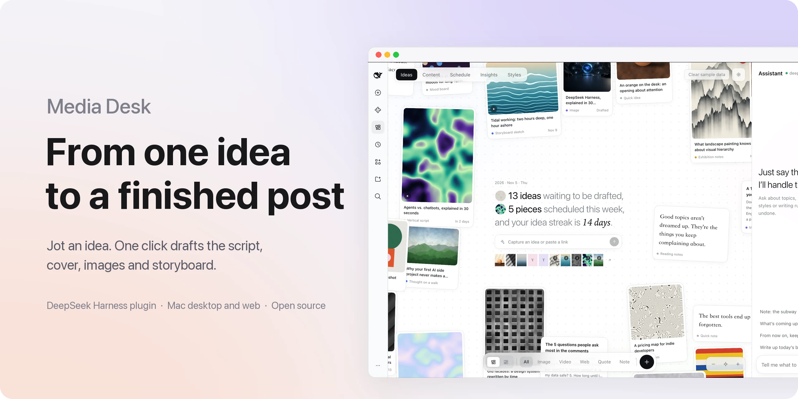
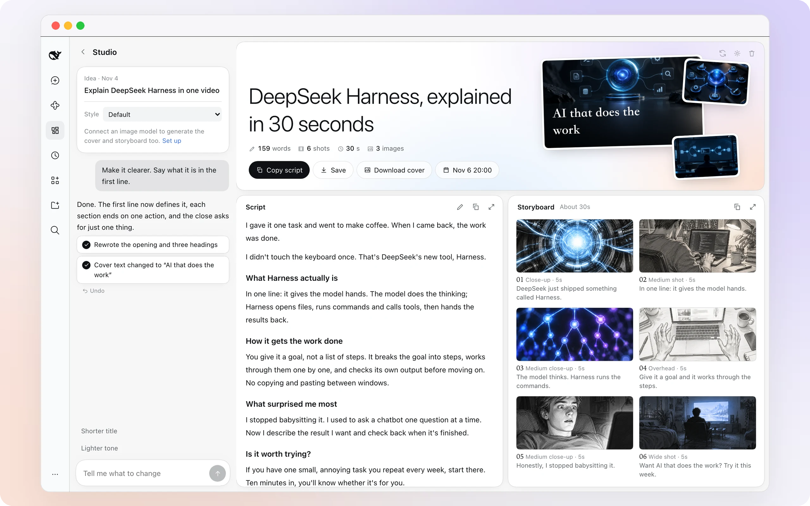
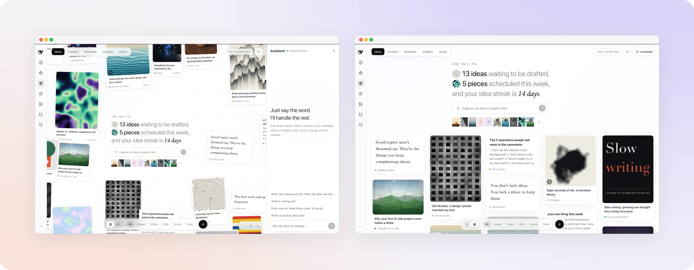
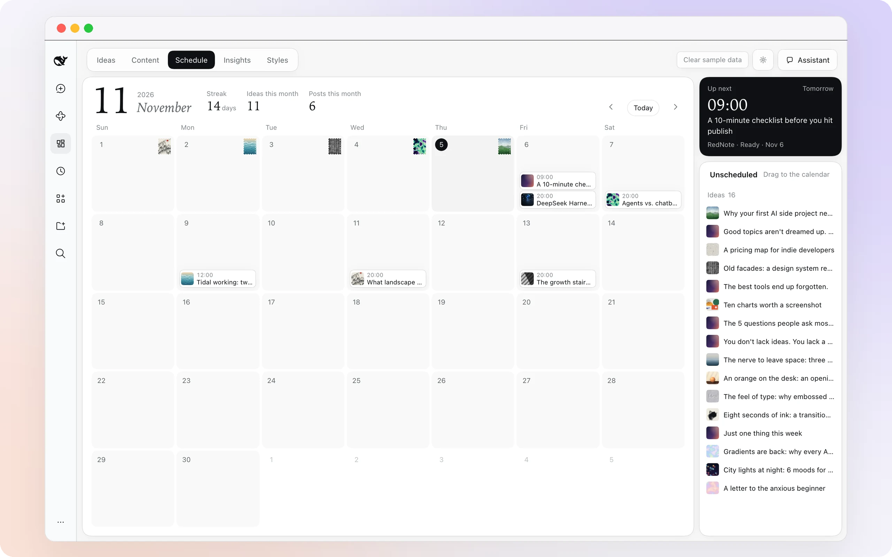
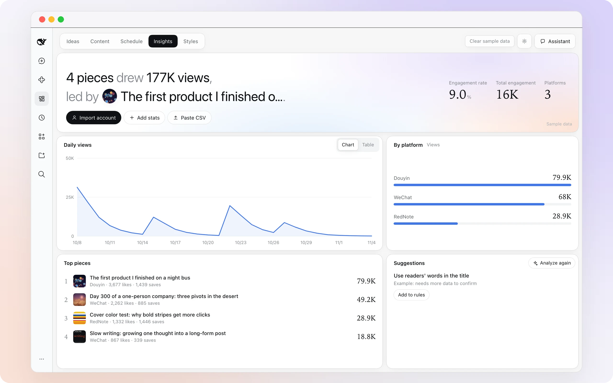
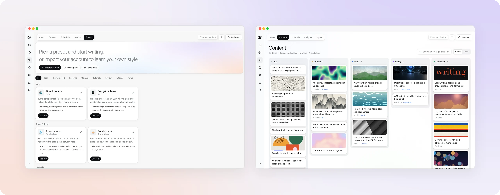

<p align="center">
  <picture>
    <source media="(prefers-color-scheme: dark)" srcset="docs/assets/hero-en-dark.webp">
    
  </picture>
</p>

<h1 align="center">Media Desk</h1>

<p align="center"><b>A Hermes Agent plugin. Capture an idea, and one click drafts the script, cover, images and storyboard.</b></p>

<p align="center">
  <a href="#get-started">Install</a> ·
  <a href="#what-it-costs">What it costs</a> ·
  <a href="#faq">FAQ</a> ·
  <a href="#credits--attribution">Credits</a> ·
  <a href="README.zh.md">简体中文</a>
</p>

<p align="center">
  
  
  
  
  <a href="LICENSE"></a>
</p>

<br>

## What it is

**Media Desk** is a dedicated creative operations workbench running inside [Hermes Agent](https://github.com/NousResearch/Hermes) and Hermes Desktop. It opens on a wall of your ideas, one line each. Open any idea, click **Draft it**, and you get a spoken script, a title, a video cover, figure collages, and a six-frame storyboard. Ask for changes in the chat dock on the left, and the draft updates on the right with single-click conflict-free undo. Then drag the finished piece onto the calendar, publish it, and review engagement analytics.

There are five pages: **Ideas · Content · Schedule · Insights · Styles**. The interface is bilingual (English and Chinese), following Hermes's active locale or configurable in plugin settings. When the interface is in English, scripts, titles, and storyboards are written in English.

Works seamlessly with TikTok, Instagram, YouTube, and X (Twitter) as well as Xiaohongshu (RedNote), Douyin, Bilibili, and WeChat.

<br>

## Draft it in one click

<table>
<tr>
<td width="62%">
  <picture>
    <source media="(prefers-color-scheme: dark)" srcset="docs/assets/f-studio-en-dark.webp">
    
  </picture>
</td>
<td valign="top">
<p><b>Everything fills in together.</b></p>
<p>The layout appears as soon as you open an idea. The title, script, cover, images, and six storyboard frames are generated in parallel and appear as each one is ready.</p>
<p><b>Ask for a change.</b></p>
<p>Try "make it punchier", "shoot frame 3 from above", or "bolder cover text". The draft updates as you watch, and every change can be cleanly undone.</p>
<p><b>Contextual text assistance.</b></p>
<p>Highlight any passage in the script to invoke the floating assistant button, quoting directly into the ChatDock.</p>
<p><b>Take it with you.</b></p>
<p>Edit the script in place, copy it, or export the whole bundle (cover, images, storyboard tables, and markdown) to a local folder with one-click OS reveal.</p>
</td>
</tr>
</table>

<br>

## The idea wall

<table>
<tr>
<td valign="top" width="38%">
<p><b>One line, one idea.</b></p>
<p>Text, links, images, videos, and quotes all become cards. Spread them out on an infinite spatial canvas with smooth spring physics, or switch to a chronological feed.</p>
<p><b>Related ideas come to you.</b></p>
<p>Type "agent" and press Enter. Your new idea is saved, and every earlier idea mentioning agents moves next to it, clustered by relevance.</p>
<p><b>An assistant on the side.</b></p>
<p>"Write up today's best idea", "What's coming up?", "From now on, keep titles under 10 words". Ask in a sentence and it's done.</p>
</td>
<td>
  <picture>
    <source media="(prefers-color-scheme: dark)" srcset="docs/assets/f-home-en-dark.webp">
    
  </picture>
</td>
</tr>
</table>

<br>

## Schedule

<table>
<tr>
<td width="62%">
  <picture>
    <source media="(prefers-color-scheme: dark)" srcset="docs/assets/f-schedule-en-dark.webp">
    
  </picture>
</td>
<td valign="top">
<p><b>One calendar for ideas and posts.</b></p>
<p>Each day you capture an idea receives a streak stamp. Drag a finished piece from the unscheduled backlog tray onto a day to lock in your editorial calendar.</p>
<p>Your next post is always pinned in the top right.</p>
</td>
</tr>
</table>

<br>

## Insights

<table>
<tr>
<td valign="top" width="38%">
<p><b>See what worked, and keep doing it.</b></p>
<p>Enter numbers by hand, paste a CSV, or import your own social profile. You'll see daily views, a breakdown by platform, and your top-performing pieces in one place.</p>
<p>Turn a suggestion into a writing rule with one click: Hermes extracts stylistic guidelines from top posts and writes them directly into reusable skills in <code>.hermes/skills/</code>.</p>
</td>
<td>
  <picture>
    <source media="(prefers-color-scheme: dark)" srcset="docs/assets/f-insights-en-dark.webp">
    
  </picture>
</td>
</tr>
</table>

<br>

## Styles

<table>
<tr>
<td width="62%">
  <picture>
    <source media="(prefers-color-scheme: dark)" srcset="docs/assets/f-style-en-dark.webp">
    
  </picture>
</td>
<td valign="top">
<p><b>Pick a voice.</b></p>
<p>Fifteen creator presets across eight categories: tech, travel and food, lifestyle, opinion, tutorials, reviews, stories, and news. Pick one and start writing.</p>
<p><b>Or use your own.</b></p>
<p>Import your account or paste a few past posts, and Media Desk learns your unique voice into a card you can refine anytime.</p>
<p>The content board tracks every piece from idea, outline, and draft to ready or published.</p>
</td>
</tr>
</table>

<br>

<a id="get-started"></a>
## Get started

Requires [Hermes Agent](https://github.com/NousResearch/Hermes) and Hermes Desktop.

### 1. Install

**Option A: Via Hermes Plugins CLI**
```bash
hermes plugins install hermes-media-desk
```

**Option B: Clone to local plugins directory**
```bash
git clone https://github.com/0dvsh0/hermes-media-house.git ~/.hermes/plugins/hermes-media-desk
cd ~/.hermes/plugins/hermes-media-desk
pip install -r requirements.txt
```

### 2. Start Backend

```bash
uvicorn dashboard.plugin_api:app --host 127.0.0.1 --port 8000 --reload
```

### 3. Open in Hermes Desktop

Launch Hermes Desktop — the **Media Desk** icon (`edit` codicon) automatically appears in your navigation sidebar at `/media-desk`. On first launch, explore the pre-seeded sample data. Click **Clear sample data** when you're ready to start fresh.

<br>

<a id="what-it-costs"></a>
## What it costs

The plugin is completely free and open-source, shipping with no proprietary key locks. All model usage runs through your own configured accounts.

| Component | What it uses | Without it |
| --- | --- | --- |
| **Script & Planning** | Model configured in Hermes Agent | Structural outline fallback |
| **Cover, images, storyboard** | Image API key in settings, or local generation provider | Script and storyboard text generated normally; typography-based cover fallback |
| **Account import** (optional) | Monid CLI data service (under $0.01 per TikTok, Instagram, or X account) | Enter metrics manually, or paste text to learn styles |

Images work with any service compatible with the OpenAI Images API (`POST {endpoint}/images/generations`). OpenAI, xAI, Volcengine Ark, Zhipu, and SiliconFlow come pre-configured, or you can supply custom endpoints.

<br>

## Import your own account

In Styles or Insights, click **Import account** and paste your public profile link. Supported platforms: TikTok, Instagram, X, Xiaohongshu (RedNote), Douyin, and Bilibili.

Connect [Monid](https://monid.ai) in three steps:

1. In Hermes Agent, run `set up https://monid.ai/SKILL.md` to install the Monid CLI.
2. Sign up at [app.monid.ai](https://app.monid.ai/access/api-keys) and generate an API key.
3. In your terminal, run `monid keys add -k YOUR_KEY -l main`.

The plugin invokes the local `monid` binary directly and never exposes your credentials.

<br>

<a id="faq"></a>
## FAQ

<details>
<summary><b>Can I import someone else's account?</b></summary>
<br>

Import only accounts you own or are authorized to inspect. Profile links are resolved via Monid according to platform terms. Only public engagement metrics are ingested.

</details>

<details>
<summary><b>Can it post directly to platforms for me?</b></summary>
<br>

No. Major social platforms do not provide open unified publishing APIs. Use the one-click export button to save your formatted Markdown scripts, video covers, figure collages, and storyboard frames to `~/Documents/Media Desk/` (or your chosen path) and reveal in your OS file manager.

</details>

<details>
<summary><b>Where is my data stored?</b></summary>
<br>

Everything stays local on your machine in `~/.hermes/plugin_data/hermes-media-desk/state.json`. Zero cloud databases, zero telemetry.

</details>

<details>
<summary><b>Does it work without an image model?</b></summary>
<br>

Yes! Scripts, titles, outlines, facts, and storyboard prompts are generated normally. The cover synthesizes a high-contrast typographical layout.

</details>

<details>
<summary><b>Is this made by Nous Research?</b></summary>
<br>

No. It is a community plugin developed for the Hermes Agent and Hermes Desktop ecosystem.

</details>

<br>

<a id="credits--attribution"></a>
## 🙏 Credits & Attribution

This project is a direct port and adaptation of the exceptional [dsh-media-desk](https://github.com/woniuniuniu/dsh-media-desk) plugin, originally created by [蜗牛的科技笔记](https://www.xiaohongshu.com/user/profile/5faedce8000000000101c8a3) (Snail's Tech Notes) for DeepSeek Harness.

We have ported the entire concept, workflows, bento grid layout, spatial canvas, and visual aesthetics into the **Hermes Agent** ecosystem (Hermes Desktop & Hermes CLI) with a native Python FastAPI backend, strict Hermes theme tokens (`var(--ui-*)`), and Hermes plugin architecture.

All original design credit, layout innovations, and creative workflows belong to **蜗牛的科技笔记** and the `dsh-media-desk` contributors. We are deeply grateful for their pioneering open-source work!

<br>

## Development

```bash
# Install dependencies
pip install -r requirements.txt

# Run test suite (226 unit and Hypothesis property tests)
python -m pytest tests/ -v

# Bundle desktop client
node scripts/build.mjs
```

| Path | Contents |
| --- | --- |
| `client/` | Modular client UI: canvas, camera, card, studio, chat, schedule, insights, styles, settings |
| `dashboard/` | FastAPI plugin backend: store, settings, pipeline, prompts, images, ops, undo, harvest, export |
| `desktop/` | Hermes Desktop plugin entrypoint (`plugin.js`, `.hermes-package.json`) |
| `scripts/` | ESM bundler and token compliance validator (`build.mjs`) |
| `assets/` | Sample images and videos |
| `docs/assets/` | High-resolution UI screenshots (dark and light mode) |
| `tests/` | Comprehensive test suite (226 unit tests and Hypothesis property invariants) |

<br>

<p align="center"><sub><a href="LICENSE">MIT</a> · A community plugin for Hermes Agent. Ported with respect from <a href="https://github.com/woniuniuniu/dsh-media-desk">dsh-media-desk</a>.</sub></p>
