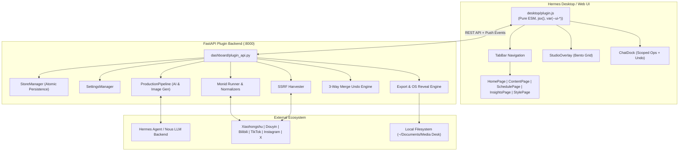

# Hermes Media Desk 🚀

> **The Intelligent Content Operations & Multimedia Publishing Desk for Hermes Agent**  
> *Built for the Nous Research Hermes Plugins Hackathon*

[](https://nousresearch.com/)
[]()
[]()
[]()
[]()

---

## 🌟 Executive Overview

**Hermes Media Desk** (`hermes-media-desk`) turns [Hermes Agent](https://github.com/NousResearch/Hermes) into a production-grade, end-to-end creative operations studio and multimedia publishing engine.

Modern creators and teams waste 80% of their bandwidth wrangling inspiration from fragmented platforms, manually reformatting scripts for diverse formats, commissioning visual assets, and juggling publication calendars. **Hermes Media Desk** bridges this gap by unifying research, production, visual asset generation, calendar planning, and audience analytics into a responsive, bilingual desktop cockpit backed by Hermes's autonomous reasoning.

---

## ✨ Key Capabilities

```
┌─────────────────────────────────────────────────────────────────────────────┐
│                             HERMES MEDIA DESK                               │
├─────────────────────┬──────────────────────┬────────────────────────────────┤
│ 💡 INSPIRATION      │ 🎬 STUDIO COCKPIT    │ 📅 PLANNING & INSIGHTS         │
│ • SSRF-Safe Harvester • 4-Step Production  │ • Visual Calendar Matrix       │
│ • 6-Platform Monid   • Bento Grid Layout    │ • Unscheduled Backlog Tray     │
│ • 50MB File Dropzone • Floating "Ask AI"   │ • Cross-Platform Analytics CSV │
│ • Multi-Hop Resolver • 3-Way Merge Undo    │ • Skill & Style Rule Extractor │
└─────────────────────┴──────────────────────┴────────────────────────────────┘
```

1. **Inspiration Ingestion & Harvester**:
   - **SSRF-Protected Scraper**: Safe retrieval with RFC 1918 / loopback address gating and redirect validation up to 4 hops.
   - **Monid CLI Integration**: Ingest content and metrics from **Xiaohongshu**, **Douyin**, **Bilibili**, **TikTok**, **Instagram**, and **X (Twitter)** with incremental engagement metric updating.
   - **Local Asset Ingestion**: 50 MiB drag-and-drop zone supporting JPEG, PNG, GIF, WebP, MP4, and WebM.

2. **One-Click AI Production Engine**:
   - Generates a full publication suite: high-converting **Cover Copy & Title**, structured **Markdown Article**, **Figure Collages**, and cinematic **Storyboard Shots**.
   - Concurrency-controlled visual asset synthesis (semaphore-gated image generation with custom prompt builders).
   - Real-time SSE / polling status updates at 700ms intervals with automatic failure recovery.

3. **Interactive Bento Grid Studio**:
   - Fluid 250ms animated expand/collapse for full-screen script editing.
   - **Contextual Selection AI Assistant**: Select any 4+ characters in the script to trigger a one-click floating action that pre-populates the AI ChatDock with clean Markdown blockquotes.
   - **AssetViewer Modal**: High-resolution gallery viewer with keyboard arrow navigation, asset regeneration, and one-click downloading.

4. **Hermes ChatDock with 3-Way Merge Undo**:
   - Scoped conversation dock with full context memory.
   - Assistant suggestions generate actionable ops with single-click conflict-free **Undo** rollback using 3-way state diffing.

5. **Editorial Calendar & Schedule Matrix**:
   - Comprehensive monthly grid with automatic 40-character ellipsis truncation.
   - Drag-and-drop or date-picker rescheduling with instant platform binding.
   - Unscheduled backlog tray sorted chronologically by creation timestamp.

6. **Style Library & Autonomous Rule Learning**:
   - Manage presets (Perspective/Cognition, Technical Deep-Dive, Narrative Storytelling, etc.) and custom tone profiles.
   - LLM-powered rule extraction analyzes top-performing posts to automatically derive reusable writing guidelines exportable directly to `.hermes/skills/`.

7. **Export & Reveal Pipeline**:
   - Exports clean folder bundles with `script.md`, figures embedded after matching headings, Markdown storyboard tables, and validated JPEG video covers.
   - One-click native OS file explorer reveal (`explorer`, `open`, or `xdg-open`).

8. **English-First Interface**:
   - Clean, professional English interface designed for international creators.

---

## 🏗️ System Architecture

Hermes Media Desk strictly conforms to the Hermes Plugin Architecture, using an asynchronous FastAPI backend service integrated with an uncompiled ESM frontend component rendered directly inside Hermes Desktop.



---

## 📁 Repository Structure

```
hermes-media-house/
├── plugin.yaml               # Hermes plugin manifest & capabilities declaration
├── dashboard/                # FastAPI backend & core processing engines
│   ├── manifest.json         # Dashboard metadata manifest
│   ├── plugin_api.py         # REST endpoints & CORS/SSRF security middleware
│   ├── store.py              # Atomic JSON store with schema migrations
│   ├── settings.py           # User preferences & API credentials
│   ├── ops.py                # 25 atomic batch ops with rollback
│   ├── produce.py            # Async concurrent production pipeline
│   ├── ai.py                 # LLM prompts for planning, articles, and shots
│   ├── images.py             # Image generation engine (HTTP & local providers)
│   ├── harvest.py            # SSRF-safe URL scraper & shortlink resolver
│   ├── monid.py              # Multi-platform Monid CLI normalizers
│   ├── style.py              # Style extraction & skill rule learning
│   ├── undo.py               # 3-way merge conflict-free undo engine
│   ├── export.py             # Export packaging & OS file reveal
│   ├── seed.py               # Bilingual demo dataset
│   └── i18n.py               # Server-side locale resolver
├── desktop/
│   └── plugin.js             # Hermes Desktop plugin entrypoint (Uncompiled ESM)
├── tests/                    # 235 comprehensive tests
│   ├── test_desktop_plugin.py       # Syntax, imports, UI rules, & task tests
│   ├── test_ops_properties.py       # Hypothesis PBT: Batch ops invariants
│   ├── test_pipeline_properties.py  # Hypothesis PBT: Production pipeline
│   ├── test_undo_properties.py      # Hypothesis PBT: 3-way merge undo
│   ├── test_settings_properties.py  # Hypothesis PBT: Settings persistence
│   ├── test_validation_properties.py# Hypothesis PBT: Security & validation
│   └── test_unit_*.py               # Comprehensive unit test suites
└── .kiro/specs/              # Complete requirements and task tracking
```

---

## 🚀 Quickstart & Installation

### Option 1: Install via Hermes Plugins CLI
```bash
hermes plugins install hermes-media-desk
```

### Option 2: Clone to Local Plugins Directory
```bash
# Clone directly into your Hermes plugins folder
git clone https://github.com/smash/hermes-media-desk.git ~/.hermes/plugins/hermes-media-desk

# Install backend dependencies
cd ~/.hermes/plugins/hermes-media-desk
pip install -r requirements.txt
```

### Starting the Plugin Backend
```bash
# Start FastAPI backend server
uvicorn dashboard.plugin_api:app --host 127.0.0.1 --port 8000 --reload
```

Launch Hermes Desktop — the **Media Desk** icon (`edit` codicon) will automatically appear in your sidebar navigation at `/media-desk`.

---

## 🧪 Testing & Quality Assurance

Hermes Media Desk is built with rigorous property-based testing and strict quality gates:

- **235 Tests Passed (100% Pass Rate)**
- **14 Hypothesis Property-Based Invariant Suites** (at least 100 random test cases executed per property):
  - *Atomic Ops Rollback*: If any op in a batch fails, preceding ops roll back cleanly.
  - *SSRF IP Filtering*: Rejection of loopback, private IPv4/IPv6, and cloud metadata endpoints.
  - *3-Way Merge Undo*: Symmetrical state reversion without race conditions.
  - *Export Filename Sanitization*: Zero illegal filesystem characters (`\ / : * ? " < > |`).
- **Strict Hermes Desktop Guidelines**:
  - Zero hardcoded colors: 100% themed via `var(--ui-*)`.
  - Zero uncompiled JSX: Authored using React 18 `jsx()` / `jsxs()`.
  - Zero unapproved dependencies: Only imports `@hermes/plugin-sdk`, `react`, and `react/jsx-runtime`.

```bash
# Run the complete test suite
python -m pytest tests/ -v
```

---

## 🏆 Hackathon Alignment (Nous Research Hermes Plugins)

| Hackathon Criterion | How Hermes Media Desk Delivers |
|---|---|
| **Ecosystem Value** | Unlocks autonomous media creation, cross-platform social analysis, and content scheduling for Hermes Agent users. |
| **Hermes Integration** | Deep integration with Hermes Desktop UI routes, sidebar nav, settings page, and Hermes Agent LLM tool dispatch. |
| **Extensibility** | Supports external image generation providers, custom Monid CLI platforms, and rule extraction into Hermes skills. |
| **Code Quality & Reliability** | Zero runtime dependencies on the frontend; 235 automated pytest and Hypothesis property tests. |
| **User Experience** | Fluid 250ms Bento Grid animations, inline AI assistance on text selection, 3-way undo, and complete bilingual support. |

---

## 📄 License

Distributed under the MIT License. Built with passion for the **Nous Research Hermes Plugins Hackathon**.
