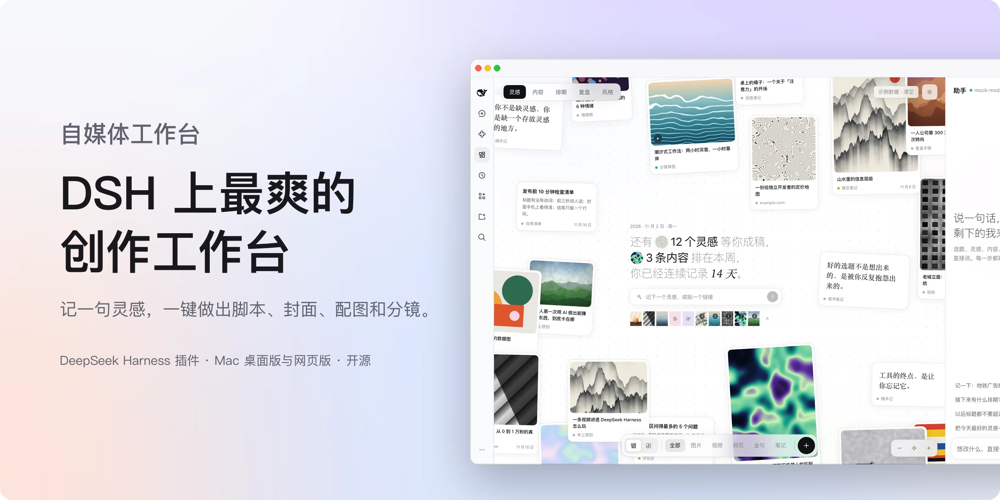
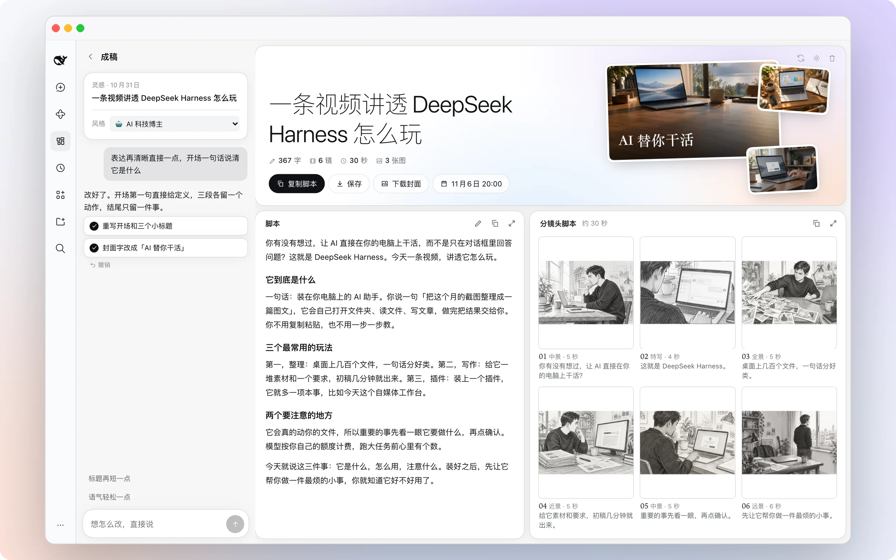
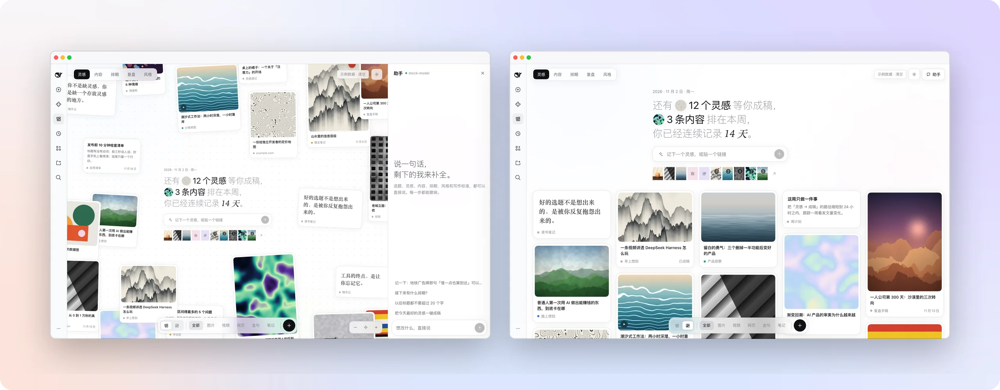
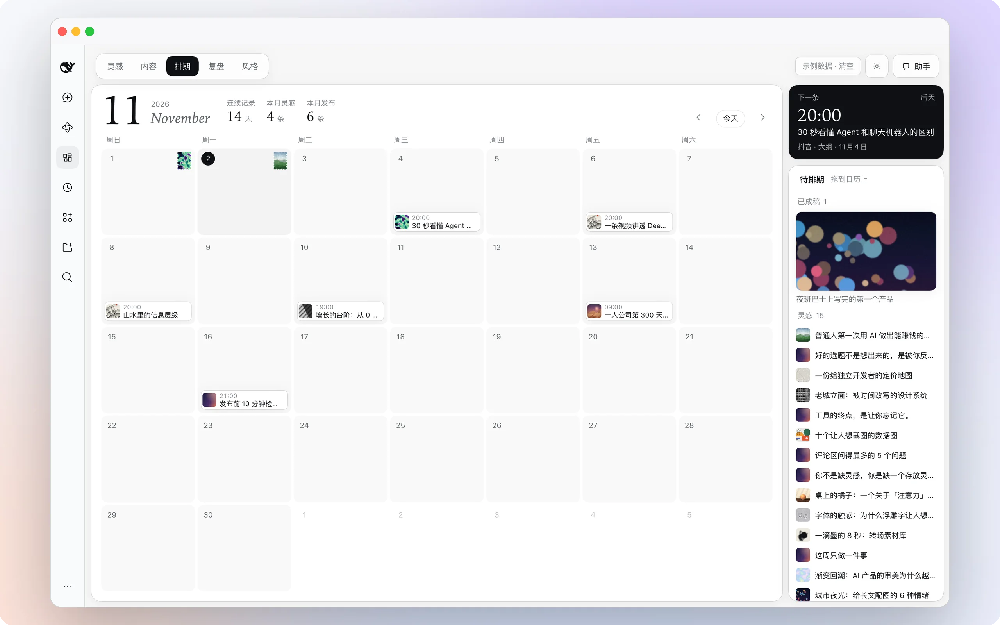
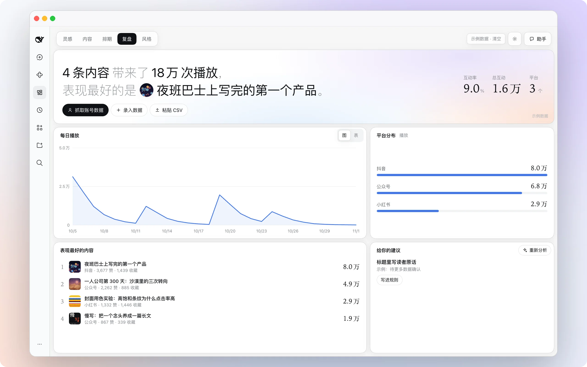
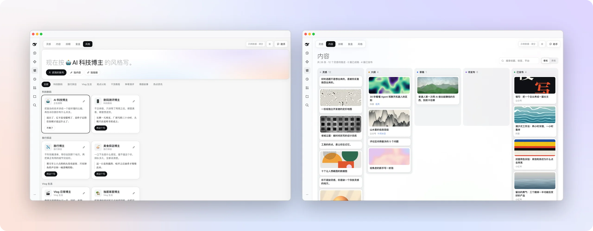

<p align="center">
  <picture>
    <source media="(prefers-color-scheme: dark)" srcset="docs/assets/hero-zh-dark.webp">
    
  </picture>
</p>

<h1 align="center">自媒体工作台</h1>

<p align="center"><b>Hermes Agent 的一个插件。记一句灵感，一键做出脚本、封面、配图和分镜。</b></p>

<p align="center">
  <a href="#三步上手">安装</a> ·
  <a href="#要花钱吗">要花钱吗</a> ·
  <a href="#问答">问答</a> ·
  <a href="#致谢与声明">致谢</a> ·
  <a href="README.md">English</a>
</p>

<p align="center">
  
  
  
  
  <a href="LICENSE"></a>
</p>

<br>

## 它是什么

装在 [Hermes Agent](https://github.com/NousResearch/Hermes) 和 Hermes Desktop 侧栏里的一个页面。打开是一面灵感墙，一句话记一个灵感；点开任何一条，一键生成口播脚本、标题、视频封面、配图和黑白线稿分镜；左边聊一句，右边就改。做好的稿子拖到日历上排期，发布之后回来看数据。

五个页面：**灵感 · 内容 · 排期 · 复盘 · 风格**。界面支持中文和英文，默认跟随系统语言，也可在插件设置里锁定。网页版和桌面版均可使用。

除了小红书、抖音、B 站、公众号，也支持 TikTok、Instagram、YouTube 和 X，发海外也能用。

<br>

## 一键成稿

<table>
<tr>
<td width="62%">
  <picture>
    <source media="(prefers-color-scheme: dark)" srcset="docs/assets/f-studio-dark.webp">
    
  </picture>
</td>
<td valign="top">
<p><b>整页一起长出来。</b></p>
<p>点开灵感，稿面的格子一开始就排好了。标题、脚本、视频封面、配图和六格分镜同时生成，一边生成一边填满。</p>
<p><b>说一句，就改。</b></p>
<p>「表达再直接一点」「第 3 镜换成俯拍」「封面字更有冲击力」，右边实时更新，每一步都能撤销。</p>
<p><b>划选直问助手。</b></p>
<p>在脚本中鼠标划选任意句子，即可一键呼出悬浮助手，自动引用至对话栏。</p>
<p><b>拿走就能用。</b></p>
<p>脚本直接编辑、一键复制；或者连封面、配图和分镜图一起，保存成一个文件夹并一键在系统资源管理器中打开。</p>
</td>
</tr>
</table>

<br>

## 灵感墙

<table>
<tr>
<td valign="top" width="38%">
<p><b>一句话，一个灵感。</b></p>
<p>文字、链接、图片、视频、金句，贴进来就是一张卡片。散落在无限画布上，或者切成按时间排的信息流。</p>
<p><b>相关的灵感自己凑过来。</b></p>
<p>在中间输入「agent」回车，新灵感记下的同时，以前提到 agent 的灵感会按相关程度挪到它旁边，一眼看全。</p>
<p><b>右边有个助手。</b></p>
<p>「把今天最好的灵感一键成稿」「接下来有什么排期」「以后标题都不要超过 20 个字」，一句话就办。</p>
</td>
<td>
  <picture>
    <source media="(prefers-color-scheme: dark)" srcset="docs/assets/f-home-dark.webp">
    
  </picture>
</td>
</tr>
</table>

<br>

## 排期

<table>
<tr>
<td width="62%">
  <picture>
    <source media="(prefers-color-scheme: dark)" srcset="docs/assets/f-schedule-dark.webp">
    
  </picture>
</td>
<td valign="top">
<p><b>一张日历，两件事。</b></p>
<p>每天一张灵感邮票，记录你的连续天数；做好的稿子从右边拖到某一天，就排好了。</p>
<p>右上角永远是下一条要发的。</p>
</td>
</tr>
</table>

<br>

## 复盘

<table>
<tr>
<td valign="top" width="38%">
<p><b>数据进来，规则出去。</b></p>
<p>手动录入、粘贴 CSV，或者导入你自己的账号。趋势、平台分布、表现最好的内容，一眼看完。</p>
<p>从数据里提炼出来的建议，点一下就写进写作规则，自动导出为 Hermes Agent 的 Skills。</p>
</td>
<td>
  <picture>
    <source media="(prefers-color-scheme: dark)" srcset="docs/assets/f-insights-dark.webp">
    
  </picture>
</td>
</tr>
</table>

<br>

## 风格

<table>
<tr>
<td width="62%">
  <picture>
    <source media="(prefers-color-scheme: dark)" srcset="docs/assets/f-style-dark.webp">
    
  </picture>
</td>
<td valign="top">
<p><b>按谁的风格写，你定。</b></p>
<p>科技数码、旅行探店、Vlog 生活、观点认知、干货教程、种草测评、情感故事、热点资讯，8 个板块 15 种博主预设，选一种就能开写。</p>
<p><b>也可以是你自己的。</b></p>
<p>导入自己的账号，或者贴几篇写过的稿子，提炼成专属风格卡，随时改。</p>
<p>内容页把所有稿子按灵感、成稿、待发布、已发布排好。</p>
</td>
</tr>
</table>

<br>

<a id="三步上手"></a>
## 三步上手

要求安装 [Hermes Agent](https://github.com/NousResearch/Hermes) 及 Hermes Desktop。

**1. 安装。**
```bash
# 方式 A：通过 Hermes CLI 安装
hermes plugins install hermes-media-desk

# 方式 B：直接克隆到本地插件目录
git clone https://github.com/0dvsh0/hermes-media-house.git ~/.hermes/plugins/hermes-media-desk
cd ~/.hermes/plugins/hermes-media-desk
pip install -r requirements.txt
```

**2. 启动后台。**
```bash
uvicorn dashboard.plugin_api:app --host 127.0.0.1 --port 8000 --reload
```

**3. 打开使用。** 打开 Hermes Desktop，侧边栏会自动出现「自媒体工作台」入口。

<br>

<a id="要花钱吗"></a>
## 要花钱吗

插件本身免费开源，不带任何内置密钥。用到模型的地方走你自己的账号：

| | 用什么 | 不接会怎样 |
| --- | --- | --- |
| **写脚本** | Hermes Agent 里配置的模型 | 只能出结构草稿 |
| **画封面、配图、分镜** | 自己的生图 API Key，或本地生图提供方 | 脚本和分镜文案照常，封面合成文字排版版 |
| **导入自己的账号**（可选） | 第三方服务 Monid，按次计费（单次约几分钱） | 手动录数据，或贴内容提炼风格 |

生图支持任何兼容 OpenAI 图片接口（`POST {接口地址}/images/generations`）的服务，设置里预填了主流平台，也支持自定义。密钥只存本机，不进内容数据。

<br>

<a id="问答"></a>
## 问答

<details>
<summary><b>只能导入自己的账号吗？</b></summary>
<br>

是。链接会发给 Monid 服务商解析公开数据，请确认符合相关平台条款。

</details>

<details>
<summary><b>能直接发布到各大平台吗？</b></summary>
<br>

不能。各大平台没有开放统一的创作者发布 API。点击「保存文件夹」，所有脚本、封面、配图与分镜会整齐打包在本地目录并一键定位。

</details>

<details>
<summary><b>我的数据存在哪里？</b></summary>
<br>

全部在本地电脑的 `~/.hermes/plugin_data/hermes-media-desk/state.json`，无云端数据库，无外部追踪。

</details>

<details>
<summary><b>没有生图模型也能用吗？</b></summary>
<br>

能。文案、分镜脚本照常生成，视频封面自动排版为高对比纯文字版。

</details>

<br>

<a id="致谢与声明"></a>
## 🙏 致谢与声明

本项目基于小红书科技博主 [蜗牛的科技笔记](https://www.xiaohongshu.com/user/profile/5faedce8000000000101c8a3) 为 DeepSeek Harness 开发的优秀开源插件 [dsh-media-desk](https://github.com/woniuniuniu/dsh-media-desk) 移植改造。

我们将原作的工作流、Bento 网格布局、无限灵感画布与视觉风格完整移植到了 **Hermes Agent** 生态中，基于 Python FastAPI 重构了后端服务，并全面适配了 Hermes 主题设计规范与插件体系。

原作的一切核心产品构思、交互设计与视觉灵感均归原作者 **蜗牛的科技笔记** 与 `dsh-media-desk` 贡献者所有。非常感谢原作者对开源社区的杰出贡献！

<br>

## 开发

```bash
pip install -r requirements.txt
python -m pytest tests/ -v
node scripts/build.mjs
```

<br>

<p align="center"><sub><a href="LICENSE">MIT</a> · Hermes Agent 社区插件。移植自 <a href="https://github.com/woniuniuniu/dsh-media-desk">dsh-media-desk</a>。</sub></p>
